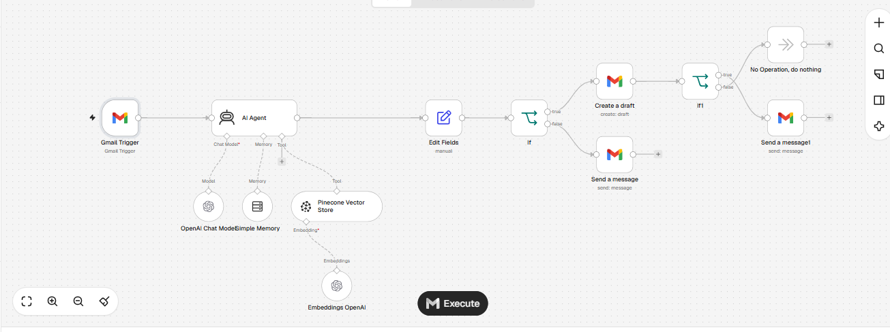

# AI Email Customer Support Agent

**Problem:** Customers email the same questions about prices and delivery all day. This agent replies to routine ones and sends sensitive or unclear ones to a person for review.

## Project Overview

An AI-powered Email Customer Support Agent built with n8n as a demo for **Blooms & Petals**, a flower shop scenario. It has not been used by a real business yet.

The agent automates customer inquiries, analyzes customer intent, generates relevant responses using business information, and escalates sensitive or complex requests for human review.

This solution demonstrates how AI-powered automation can streamline customer support operations, reduce repetitive tasks, and improve operational efficiency.

**Project Type:** AI Agent & Business Automation

**Project Status:** Built and tested as a demo. Ready to be adapted for a real business.

## Business Problem

Businesses often receive repetitive customer emails about product prices, delivery, availability, and services.

Manually reviewing and responding to every email can be time-consuming and may lead to delayed responses.

## AI-Powered Solution

This workflow uses AI to understand incoming customer emails, identify their intent, and generate relevant responses using available business information.

It also includes human-review logic for sensitive, urgent, or low-confidence inquiries.

## Key Features

- Automated email processing through Gmail
- Customer intent and category classification
- Customer sentiment and urgency detection
- AI-generated professional email responses
- Confidence-based decision-making
- Human review for sensitive and low-confidence inquiries
- Gmail draft creation for messages requiring approval

## How It Works

1. A customer sends an email to the business.
2. Gmail Trigger detects the incoming email.
3. AI analyzes the customer's message.
4. The workflow identifies intent, sentiment, urgency, and confidence.
5. Routine inquiries are handled through the automated response path.
6. Sensitive or low-confidence inquiries are routed for human review.

## Technologies Used

- n8n
- Gmail
- Large Language Models (LLMs)
- Google Workspace
- AI Prompt Engineering
- Workflow Automation

## Workflow Screenshot

## Demo Video

Demo video coming soon. Message me for a live demo.
## Project Outcome

A working demo of an email assistant that saves staff time on routine questions while keeping a person in control of sensitive replies. Next step: test it with a real business inbox.
---

**Developed by Annus Salam**
Want a version for your business? Message me: [your email] | [your LinkedIn or Instagram link]
